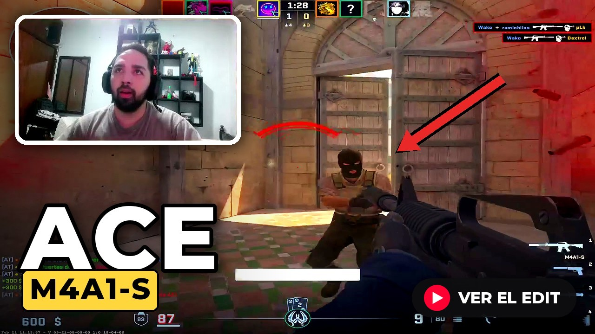
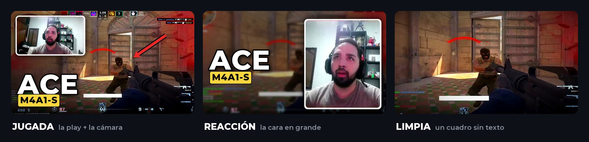
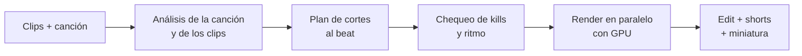

<div align="center">

# WAKO Edits

**Montajes de CS2 al ritmo de la música, armados por Claude Code y renderizados en tu PC.**

Dejás los clips y una canción, escribís `/cs2-pack` y sale el edit para YouTube, los shorts, la miniatura y los textos.


<br>

<a href="https://youtu.be/ZxsmGS2iv9Q"></a>

<sub>Miniatura generada por el proyecto · clic para ver el edit completo</sub>

</div>

<br>

## Qué hace

<table>
<tr>
<td width="50%"></td>
<td>

🎵 **Corta al golpe exacto** de la canción: BPM, drops y cortes de batería, con voz y música separadas.

🎯 **Encuentra tus kills** en el killfeed y el disparo en el audio. Cada drop abre con una kill digna.

✨ **Efectos con medida:** transiciones con luz, intro con logo y cierre con la reacción del streamer.

⚡ **Renderiza en tu GPU**, en paralelo y con caché: corregir algo tarda segundos.

</td>
</tr>
</table>

Además arma las miniaturas en tres estilos, basados en las más vistas de canales de CS:



## Cómo se usa

```bash
git clone https://github.com/NicLen17/wako-edits.git
```

**Instalá** con `install.ps1` en Windows (o doble clic en `setup_windows.bat`) o `./install.sh` en Linux y macOS: arma el
entorno, detecta tu placa de video y te dice cómo va a renderizar. Detalle y problemas frecuentes en
[docs/instalacion.md](docs/instalacion.md); `python engine/doctor.py` muestra el diagnóstico cuando quieras.

Después hay tres formas de usarlo, sobre el mismo motor y los mismos archivos:

**1. Un comando.** Clips `.mp4` y una canción en una carpeta, y sale un borrador:

```bash
python engine/auto.py entrada
```

Analiza la canción y los clips, elige y ordena las mejores plays y renderiza. Con `--final` hace el video en 1080p60.

**2. El editor web** (opcional), para ajustar cortes, títulos, transiciones y estilo, y ver el render paso a paso:

```bash
python engine/ui/server.py
```

**3. Con Claude Code**, que es como sale el mejor resultado: revisa las kills dudosas, confirma los drops a oído y
arma además shorts, miniatura y textos. Abrí la carpeta en Claude Code, dejá los clips y la canción en `entrada/` y pedí:

```
/cs2-pack
```

Claude solo te pregunta lo que no puede detectar (un arma dudosa, algún golpe de la canción) y al final te deja todo en `output/<nombre>/` (`video/`, `shorts/` e `info/`):

| Sale | Qué es |
|---|---|
| 🎬 **YouTube** | el edit en 1920×1080 |
| 📱 **Shorts** | 2 a 4 verticales para TikTok, Reels y YouTube Shorts, sin repetir tramos |
| 🖼️ **Miniatura** | en los tres estilos |
| 📝 **Textos** | título, descripción con capítulos, tags y textos de cada red |

**Para corregir**, decile los minutos como a un editor: *"en el 1:23 no se ve la tercera kill"*. Solo se vuelve a renderizar lo que cambió.

<details>
<summary><b>Requisitos e instalación a mano</b></summary>

<br>

- Windows 10/11 (los scripts también corren en macOS y Linux), Python 3.11+, `ffmpeg` y `ffprobe` en el PATH.
- GPU opcional: con OpenGL 4.3 (cualquier AMD, NVIDIA o Intel de los últimos años) todo el render corre en la placa; para codificar usa AMD AMF, NVIDIA NVENC o Intel QSV. Sin GPU, todo en la CPU (más lento, mismo resultado). 16 GB de RAM o más.
- [Claude Code](https://claude.com/claude-code): la app de escritorio o el CLI `claude`.

```bash
python -m pip install -r requirements.txt
```
```bash
python -m pip install demucs
```
```bash
python engine/encoders.py
```
```bash
python engine/setup_rife.py
```

`encoders.py` muestra qué codificador vas a usar. `setup_rife.py` (opcional, baja ~410 MB una vez) instala RIFE para las cámaras lentas en la GPU. Con GPU todo el render corre en la placa (`--device gpu`, por defecto si la hay): en un Ryzen 5 7600X con una RX 7900 XT un edit de 2:30 sale en ~1 minuto.

</details>

<details>
<summary><b>Cómo funciona por dentro</b></summary>

<br>



Las reglas de edición del canal viven en `.claude/skills/` y los scripts de `engine/` hacen el trabajo pesado.

| Skill | Para qué |
|---|---|
| `cs2-pack` | Todo en uno, el arranque por defecto |
| `cs2-edit` | Arma, corrige y renderiza el edit largo |
| `cs2-short` | Shorts verticales 9:16 |
| `yt-publish` | Miniatura, título, capítulos y tags |
| `clip-catalog` | Recuerda los clips ya verificados |
| `edit-style-learner` | Copia el estilo de un edit descargado (`hacé uno así`) |

</details>

## Notas

- **Música:** la canción la ponés vos. Casi todas las comerciales generan un reclamo de Content ID en YouTube. La letra nunca va en pantalla. Leé [docs/musica-y-derechos.md](docs/musica-y-derechos.md) antes de publicar.
- **Tus archivos:** los clips se copian al proyecto y los originales no se tocan. Los videos y clips no se suben al repo.
- **Tu canal:** el nombre, el logo, los colores y el estilo son un preset, no código. Creá `presets/<tucanal>/preset.json`, elegilo en `config.json` y listo: [docs/presets.md](docs/presets.md). Solo CS2 por ahora.
- **Qué está probado:** Windows con placa AMD. NVIDIA, Intel, Linux y macOS están implementados pero sin probar en hardware real ([tabla](docs/instalacion.md)); si lo corrés ahí, contá cómo te fue.
- **Para aportar:** [CONTRIBUTING.md](CONTRIBUTING.md) y [docs/extender.md](docs/extender.md). Formato de un edit: [docs/edit-json.md](docs/edit-json.md). Licencia [MIT](LICENSE).
