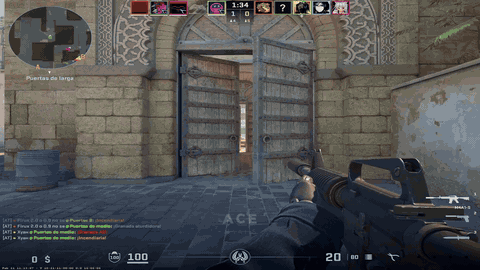
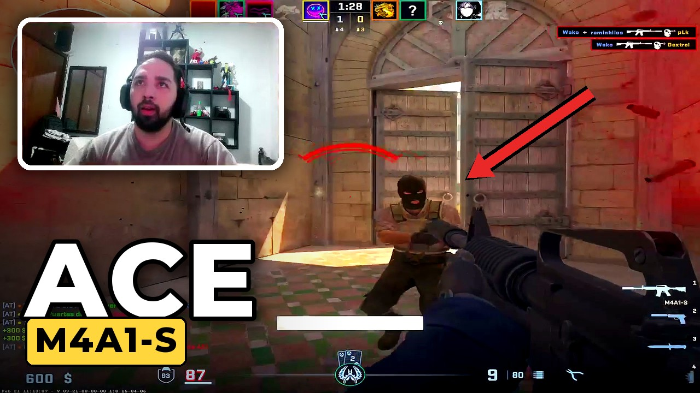
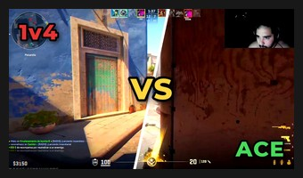
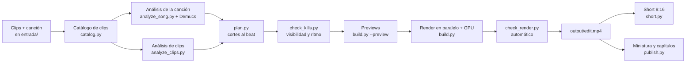

# WAKO Edits — montajes de CS2 con Claude Code, renderizados en tu PC

Dejás tus clips de Twitch y una canción, escribís `/cs2-edit hacé un edit`, y Claude Code arma un montaje estilo **WAKO TV**: cortes al beat, una kill en cada drop, efectos sutiles en las kills, transiciones con luz, intro con logo y cierre con la reacción del streamer. Todo corre en tu computadora: análisis de la música, detección de kills, render en paralelo con la GPU y exportación.

## Resultado

[](https://youtu.be/ZxsmGS2iv9Q)

▶️ **[Ver el edit completo en YouTube](https://youtu.be/ZxsmGS2iv9Q)**

| Segundo drop (ráfaga de un ACE, una kill por golpe) | Miniatura generada por `yt-publish` (tipo `jugada`) |
|---|---|
|  |  |

Los tres tipos de miniatura que genera `yt-publish` (`jugada`, `reaccion`, `limpia`), vistos al tamaño del celular. Salen del análisis de las miniaturas más vistas de canales de CS con éxito ([referencias](.claude/skills/yt-publish/references/miniaturas.md)):



Lo que hace el proyecto en cada video:
- **Música:** encuentra el BPM, el onset real de cada golpe (no el beat estimado), los drops, el corte de batería y los golpes de voz. Separa voz y música con Demucs.
- **Clips:** detecta las kills propias en el killfeed y el instante exacto del disparo en el audio. Claude las verifica a ojo con hojas de cuadros.
- **Plan:** cada kill importante cae exactamente en un golpe (0 ms), cada drop arranca con una kill digna, y ninguna kill queda tapada por una transición ni cortada.
- **Chequeos automáticos:** visibilidad de cada kill y tiempos muertos antes de renderizar; tirones, 60 fps, duración y volumen después.
- **Render:** pedazos de 6 s en paralelo con todos los núcleos, codificados con la GPU (AMD AMF / NVIDIA NVENC / Intel QSV, o CPU si no hay). Las correcciones solo vuelven a renderizar lo que cambió.

## Cómo funciona



Claude Code sigue las reglas de edición del canal, que están en `.claude/skills/cs2-edit/` (qué mostrar de cada play, mínimos de visibilidad, drops, efectos, texto, audio). Los scripts de `engine/` hacen el trabajo pesado.

## Requisitos

| | |
|---|---|
| Sistema | Windows 10/11 (los scripts también corren en macOS/Linux con Python y ffmpeg) |
| Python | 3.11 o más nuevo |
| ffmpeg | en el PATH (`ffmpeg` y `ffprobe`) |
| GPU | opcional: AMD (AMF), NVIDIA (NVENC) o Intel (QSV). Sin GPU codifica con la CPU |
| Memoria | 16 GB o más recomendado (el render usa un proceso por núcleo) |
| Claude Code | la [app de escritorio](https://claude.com/claude-code) o el CLI `claude` |

Probado en un Ryzen 5 7600X, 32 GB y una RX 7900 XT: un edit de 2:30 se renderiza en pocos minutos, y una corrección chica en segundos.

## Instalación

1. Cloná el repo:
   ```bash
   git clone https://github.com/NicLen17/wako-edits.git
   ```
2. En Windows, doble clic en `setup_windows.bat`. Instala Python y ffmpeg con `winget`, las librerías de `requirements.txt` y Demucs (la primera vez descarga ~2 GB). Si te pide permisos, aceptá; al terminar, cerrá y volvé a abrir la terminal.

   En otro sistema, o a mano:
   ```bash
   python -m pip install -r requirements.txt
   ```
   ```bash
   python -m pip install demucs
   ```
3. Comprobá qué codificador vas a usar (con una Radeon tiene que decir `amf`):
   ```bash
   python engine/encoders.py
   ```
4. Abrí la carpeta en Claude Code (app de escritorio → Code → abrir carpeta, o `claude` en una terminal dentro de la carpeta).

## Tu primer edit (paso a paso)

1. **Dejá los archivos en `entrada/`:** los clips `.mp4` (1080p, 60 fps; los de 50 fps se convierten solos) y la canción (`.mp3`, `.wav` o `.m4a`). Opcional: `logo.png` con tu avatar.
2. **Pedilo en Claude Code:**
   ```
   /cs2-edit hacé un edit
   ```
   No hace falta nada más: Claude crea `projects/<nombre_de_la_canción>/`, copia los clips (los originales no se tocan) y arranca.
3. **Respondé lo que no se puede detectar solo.** Claude no puede escuchar la canción, así que puede preguntarte en qué momentos hay golpes de voz tipo "bang bang" o qué arma es en una play dudosa. Todo lo demás lo decide solo y te lo cuenta al final.
4. **Esperá el render.** Claude revisa previews de los momentos clave antes del render completo, renderiza en segundo plano y lee el chequeo final.
5. **Mirá el video** en `output/<nombre>.mp4`.

### Corregir
Pedí los cambios con los minutos del video, como se lo dirías a un editor:
```
en el 1:23 no se ve la tercera kill, y subí un poco el sonido del juego
```
Claude ubica cada minuto con `engine/locate.py` (qué clip, qué kill, qué transición, con tiras de cuadros), corrige el plan y vuelve a renderizar solo los pedazos que cambiaron.

### Después del edit
- **Short vertical** para TikTok, Reels o Shorts: `hacé un short de este edit` → `output/<nombre>_short.mp4` (1080×1920). Elige solo el tramo con mejor gancho, sin cortar plays.
- **Paquete para YouTube:** `prepará la subida` → miniaturas 1280×720 en tres estilos (la jugada con la cámara del streamer, la reacción en grande, o un cuadro limpio), títulos, descripción con capítulos válidos y tags en `projects/<nombre>/publish/`. No sube nada.
- **Estilo de otro edit:** adjuntá un edit **descargado** y pedí `hacé uno así` → mide cortes, sincronía, transiciones, efectos y color, y los aplica a tus clips.

## Skills del proyecto

| Skill | Para qué |
|---|---|
| `cs2-edit` | **Por defecto.** Arma, corrige y renderiza el edit. Reglas de corte, visibilidad, drops, efectos, texto y audio. |
| `clip-catalog` | Guarda cada clip verificado una vez (kills, disparos, arma, mapa, puntaje, dónde se usó) para no volver a revisarlo. |
| `cs2-short` | Short vertical 9:16 a partir del edit terminado. |
| `yt-publish` | Miniatura, título, descripción con capítulos, tags y aviso de derechos de la canción. |
| `edit-style-learner` | Aprende el estilo de un edit de referencia descargado y lo recrea. |

## Estructura

```
engine/                  análisis, plan, render, audio y chequeos
  analyze_song.py        BPM, onsets, drops, golpes vocales
  analyze_clips.py       killfeed, hojas de cuadros, disparos exactos
  catalog.py             catálogo de clips verificados (catalog/clips.json)
  check_kills.py         visibilidad de cada kill y tiempos muertos
  build.py               render en paralelo con caché y GPU (+ check_render automático)
  render.py, audio.py    imagen y mezcla
  check_render.py        tirones, 60 fps, duración, LUFS
  locate.py              minuto del video → clip, kill y transición, con tiras de cuadros
  short.py               short vertical 9:16
  publish.py             miniatura, capítulos y datos para YouTube
projects/<nombre>/       un proyecto por video (clips, canción, plan.py, análisis, caché)
projects/my_jealousy_v3/plan.py   el plan de referencia que se copia en cada edit nuevo
.claude/skills/          las reglas que sigue Claude
entrada/                 dejá acá los clips y la canción del próximo edit
output/                  videos terminados
```

## Roadmap

- [x] Edit completo desde clips + canción, con render local en GPU y caché de pedazos
- [x] Chequeos automáticos de visibilidad de kills, ritmo, tirones y volumen
- [x] Catálogo de clips verificados reutilizable entre edits
- [x] Short vertical y paquete para YouTube
- [x] Aprender el estilo de un edit de referencia
- [ ] Prueba de regresión: comparar previews de un proyecto fijo al cambiar `render.py`
- [ ] Detección de armas por el ícono del killfeed (hoy se verifica a ojo)
- [ ] Soporte para clips con la cámara en otras posiciones en el layout `cam` del short

## Notas

- **Música:** la canción es tuya de conseguir. Casi todas las canciones comerciales generan un reclamo de Content ID en YouTube; `yt-publish` te recuerda revisarlo antes de publicar. Nunca se pone la letra en pantalla.
- **Tus archivos:** los clips de `entrada/` se copian al proyecto; los originales no se modifican ni se borran. `entrada/`, `output/`, `catalog/` y los clips de los proyectos no se suben al repo (`.gitignore`).
- Las reglas de edición son las del canal WAKO TV (`twitch.tv/el_wako`). Para otro canal, cambiá los datos de §0 de `.claude/skills/cs2-edit/SKILL.md`, el logo y los textos de intro y cierre en `engine/render.py`.
